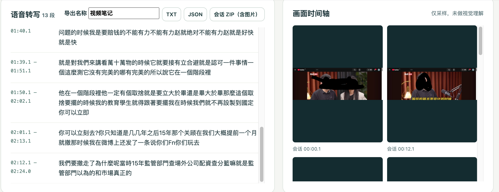
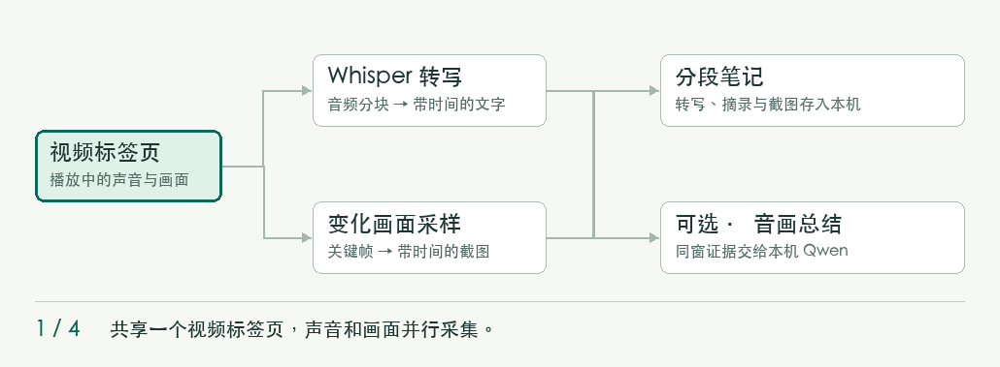

# 听见 · 看见

没空看完整段讲座，想先读笔记、再挑重点回看？把视频放在浏览器标签页里播放，即使没有字幕，Whisper 也能在本机把讲解转成文字。项目默认每 12 分钟保存一份笔记，包含带时间的转写、讲解摘录和画面变化时保留的截图。单次最长支持 120 分钟。

**私人录像和付费会员课也可以留在自己电脑上处理。** 你只需共享视频所在的标签页。首次加载模型需要联网，视频、截图和转写内容都在本机处理，无需交给第三方 AI 服务。会员视频能否采集取决于播放器的内容保护。

## 实际运行效果



## 工作原理



## 在本机使用

准备 Node.js 22.12 或更高版本，以及桌面版 Chrome 或 Edge。在项目目录运行：

```sh
npm ci
npm run dev
```

1. 打开[本地应用](http://127.0.0.1:4183/)，点击「加载识别模型」。
2. 点击「开始共享」，选择正在播放视频的标签页，勾选「共享标签页音频」。想一边听歌一边记笔记，可以在共享前勾选「仅转写，自己不听视频」。
3. 在「已保存分段」查看摘要或下载包含截图的 ZIP。结束时点击「停止并完成队列」，最后不足一段的内容也会保存。

启动后还可以[逐步播放架构图](http://127.0.0.1:4183/docs/video-architecture.html)。需要结合画面做 AI 总结时，先安装 `llama.cpp`，再另开终端运行 `bash scripts/start-vision.command`（首次下载约 2.1 GB 模型）。

[MIT 许可](LICENSE) · [测试记录](TESTING.md) · [公开测试音频来源](https://huggingface.co/datasets/Xenova/transformers.js-docs/resolve/main/jfk.wav)
